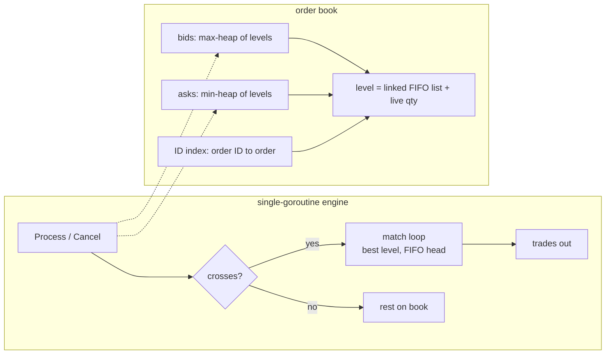

# matchbook

A stock exchange has a program at its center that pairs people who want to buy
with people who want to sell. It is called a matching engine, and it has to be
both extremely fast and completely predictable: the same stream of orders must
always produce the exact same trades, or the exchange cannot be trusted or
tested.

matchbook is my version of that core, written in Go. It handles one instrument
on one thread with no locks, which is what makes it predictable. Orders are
matched by price first and then by who got there first, big orders can fill
partially, cancelling is instant, and it can report how much buying and selling
interest sits at each price. On a realistic order flow it handles about 13
million commands per second on a laptop, with half of them done in under 85
nanoseconds, and it allocates no memory once warmed up. It is tested by
throwing random order streams at it and checking the rules always hold, and
by replaying a full day of real NASDAQ order messages through it and
checking that its book matches the exchange's after every message.

## Features

- **Limit and market orders** with price-time (FIFO) priority and partial fills
- **Time in force**: GTC rests, IOC fills what crosses and drops the rest,
  FOK fills completely or not at all (checked before anything trades)
- **Post-only** orders are rejected rather than allowed to take liquidity
- **Self-trade prevention** keyed on an owner ID, with a per-engine policy:
  off, cancel the incoming remainder, or cancel the resting order and keep
  matching
- **Cancel-replace with real priority rules**: shrinking an order at the same
  price keeps its place in the queue; a price change or size increase loses
  it and re-enters as a new order, which may trade immediately
- **Price improvement to the taker** — fills always execute at the maker's price
- **O(1) cancels**: each price level is an intrusive linked list, so a cancel
  unlinks its order wherever it sits and nothing dead is left in the queue
- **Explicit outcomes**: every order comes back as rested, filled, discarded,
  or rejected with a reason (bad quantity, bad price, duplicate ID)
- **Sequenced event stream**: every command emits gap-free numbered events
  (accepted, fill, rested, discarded, cancelled, rejected) that are enough to
  rebuild the book and every trade downstream, plus a running digest of all
  events ever emitted
- **Journal, snapshot, and replay**: commands append to a fixed-width binary
  journal; replaying it into a fresh engine reproduces the exact same events
  and digest. A snapshot captures the resting book so recovery is snapshot
  plus the journal tail, not the whole history
- **Aggregated depth snapshots** (top-N levels per side)
- **Zero allocation in steady state**: resting orders and price levels are
  recycled through a pool, the trade and event buffers are reused, and the
  price heap never boxes values. Tests assert that warmed-up quote churn
  allocates nothing. Integer tick prices keep floats out of matching entirely

## Architecture



Each side of the book keeps a binary heap of price levels, so the best price
is one slice read, and a map from price to level that is only consulted when
an order rests. Each level is a doubly linked list of orders in arrival
order, and every order points back at its level. That makes fills, cancels
and in-place reductions O(1) with no lookup. Emptied levels are pruned
lazily when they reach the top of the heap, so the heap never needs random
deletion. Filled and cancelled orders, and pruned levels, go back to a pool
and are reused, which is why steady-state trading does not allocate.

The remaining map is the order-ID index, which arbitrary client IDs require.
Profiling shows it is now most of the map cost. A fixed-range price ladder
was considered and rejected. The price map accounts for about 2% of engine
time, and a ladder would force every caller to declare a price range up
front.

Scaling out is by sharding: one engine goroutine per instrument, orders routed
by symbol. Nothing in the core needs a mutex.

## Benchmarks

All numbers below come from one machine and one method: an Apple M1 MacBook
Pro with 8 GB of memory on macOS 26.4, Go 1.27.2. Each row is the
median of five runs of `go run ./cmd/bench`, 2 million commands each.

**The workload.** The headline flow is *stationary*: the book holds about
1,300 to 1,700 resting orders around a drifting mid price, the way a live
book does. A third of commands are cancels of live orders. The rest are
mostly passive quotes near the touch, with some aggressive limits and a few
market orders, producing about 630,000 trades. The stream is generated by
`internal/flow` and is deterministic, so every run does identical work, and
the bench checks that by comparing digests.

The original benchmark flow is kept as *growing*: uniform prices over 40
ticks, 10% market orders, no cancels. About one order in eight rests forever,
so the book grows without bound. It is a stress test, not a model of a
market. Earlier versions of this README quoted it as the headline number.

**How it is measured.** Throughput comes from a pass with no clock reads in
the loop. Latency comes from a second pass that times each command. The clock
on this machine ticks every 42 ns, so every latency is a multiple of 42 ns and
includes about 16 ns of measurement cost. Allocation is total bytes allocated
divided by commands.

| | stationary, before | stationary, now | growing, before | growing, now |
|---|---|---|---|---|
| throughput | 10.4M/s | **13.4M/s** | 5.8M/s | **8.1M/s** |
| time per command | 96 ns | **75 ns** | 172 ns | **124 ns** |
| latency p50 | 83 ns | 83 ns | 166 ns | 125 ns |
| latency p99 | 333 ns | **167 ns** | 500 ns | 375 ns |
| latency p99.9 | 667 ns | **250 ns** | 2,042 ns | 875 ns |
| bytes allocated per command | 42.9 | **0.17** | 77.4 | 19.9 |

"Before" is the engine as of the order-types release, measured with the same
harness and the same streams. The 0.17 bytes per command on the stationary
flow is the pool filling up during the first few thousand commands; after
that, nothing is allocated. The growing flow still allocates because its book
really does grow.

The maximum latency in any run is tens of microseconds and varies run to run.
Those outliers come from the operating system, not the engine, and are not
reported as a figure. A run occasionally comes out much slower overall when
the laptop is busy with something else, which is why medians are used.

Per-operation microbenchmarks with allocation counts live in
`bench_test.go`. On pull requests, CI runs them on the base and the head and
posts a benchstat comparison. To compare locally:

```
go test -run='^$' -bench=. -benchmem -count=10 > old.txt
# change something
go test -run='^$' -bench=. -benchmem -count=10 > new.txt
go run golang.org/x/perf/cmd/benchstat@v0.0.0-20261009192801-be2c69fb417e old.txt new.txt
```

## Replaying real NASDAQ data

NASDAQ publishes full trading days of its TotalView-ITCH 5.0 feed. The feed
lists every displayed order added, executed, cancelled, deleted or replaced,
with NASDAQ's own order references. `cmd/itchreplay` drives one engine per
symbol from that feed. Next to each engine it keeps a second book built only
from the messages, with no matching logic, as an independent record.

Two things are checked:

- **The book.** After every message, the engine's best bid and ask and their
  sizes must equal the feed's. The full depth is compared level by level
  every 10,000 messages and at the close.
- **Priority.** When NASDAQ reports that a resting order executed, the
  engine must agree that this order was first in line at the best price.
  The trade is then replayed through the engine's real matching code, and
  the fill must be exactly that order, at its price, for the reported size.

Results for 30 December 2019, a full day for five symbols:

| symbol | messages | executions | replayed with NASDAQ's exact fill | receipt-order cases | unexplained |
|---|---|---|---|---|---|
| AAPL | 1,519,864 | 60,203 | 59,552 | 651 | 0 |
| AMZN | 536,078 | 15,094 | 14,692 | 402 | 0 |
| INTC | 753,342 | 18,892 | 18,872 | 20 | 0 |
| MSFT | 1,221,477 | 34,739 | 33,664 | 1,075 | 0 |
| QQQ | 2,376,742 | 21,075 | 20,921 | 154 | 0 |

The engine's top of book matched the feed after all 6.4 million messages,
and all 642 full-depth comparisons matched. No execution went to an order
away from the best price, and none produced a different fill. The replay
takes under 8 seconds.

**The receipt-order cases.** About 1.5% of executions went to a different
order at the best price than the one the engine had first. Every one
follows the same pattern. NASDAQ executed an order that appeared in the
feed later but carries a lower order reference. NASDAQ assigns references
when it receives an order, so these are orders it received earlier and
published later, and they kept their place in line. Many arrive in batches
just after the 9:30 open. To check this was the whole story rather than a
convenient label, every execution in the day was tested against it. In
150,003 executions the executed order was the lowest reference at its price
every time, with no exceptions. The engine ranks orders by when they reach
it, which is the right rule for a matching engine, so it was not changed.
The replay counts a disagreement as explained only when it fits this
pattern exactly, and fails on anything else.

Executions in the opening and closing auctions, trades against hidden
orders, and trading halts are applied or counted but are not continuous
matching, so they are not part of the priority check.

To reproduce, stream NASDAQ's file through the extractor. The 3.5 GB day
file is never stored; the extract for these symbols is about 70 MB. Then
replay it:

```
curl -s 'https://emi.nasdaq.com/ITCH/Nasdaq%20ITCH/12302019.NASDAQ_ITCH50.gz' |
  go run ./cmd/itchextract -symbols AAPL,AMZN,INTC,MSFT,QQQ -o data/itch-20191230.itch.gz
go run ./cmd/itchreplay data/itch-20191230.itch.gz
```

The extractor prints the input's SHA-256. The file used above was
3,524,013,057 bytes with SHA-256
`ef03df46a27e6bda4dead017f84c2e3979df7211f02c7868b51d53fceb99c689`. With the
extract in place, `go test ./internal/replay` also runs the whole day as a
test and requires zero unexplained results and identical digests across two
replays. That takes about 15 seconds, or about 6 minutes under `-race`;
`-short` skips it. The data is not committed, because NASDAQ's terms do not clearly
allow redistribution.

## Testing

- **Property-based suite**: 300 random scenarios × 400 operations, each
  cross-checked operation-by-operation against a naive O(n) reference
  implementation — status, trades, cancels, replaces, top-of-book, and depth
  must be identical. The stream mixes GTC, IOC, FOK, post-only and market
  orders, owners from a small pool so self-trades happen, replaces, duplicate
  IDs and invalid prices, and the self-trade policy rotates across scenarios.
  The book-never-crossed invariant is asserted after every op.
- **Fuzzing**: `go test -fuzz=FuzzEngineVsReference` decodes arbitrary bytes
  into order streams and checks the engine against the reference model, so
  the fuzzer can search for sequences the random suite never generates.
- **Golden determinism test**: a fixed 50,000-operation stream must hash to
  the same value on every run and every machine. If behaviour changes, this
  test says so.
- **Replay and recovery properties**: a journaled random stream replayed into
  a fresh engine must reproduce the same event digest and depth. Separately,
  the engine is stopped at a random point, snapshotted, restored, and both
  copies are fed the rest of the stream; every event must be identical.
- **Journal robustness**: a journal torn mid-record replays the whole records
  before the tear and reports the tear; corrupt records and bad snapshots
  are refused, including one that would restore a crossed book.
- **Conservation property**: read from the engine's own event stream, every
  unit of accepted quantity is provably filled, resting, cancelled, reduced,
  or discarded, under every self-trade policy.
- **Recycling invariants**: after long random streams under every self-trade
  policy, a checker walks every level's list and verifies the links, FIFO
  order, totals, and that no order or level is both in use and in the pool.
  A deliberately planted double-recycle bug was confirmed to fail it.
- **Zero-allocation tests**: warmed-up quote churn, at the front of a level
  and behind a live order, must allocate nothing.
- Table-driven unit tests for FIFO priority, price priority, partial fills,
  price improvement, IOC semantics, cancels, duplicate-ID rejection, input
  validation, and cancels that would once have leaked queue slots.
- **Real exchange data**: a full NASDAQ trading day replays with the book
  matching after every message (see above). The ITCH parser is tested
  against a message written byte by byte from the specification, and the
  replay's checks are tested against a deliberately tampered engine.
- `go test -race -cover ./...` gives **99.5% statement coverage** on the
  engine, race-clean.

## Usage

```go
eng := matchbook.NewEngine()

eng.Process(matchbook.Order{ID: 1, Side: matchbook.Sell, Type: matchbook.Limit, Price: 100, Qty: 10})
res := eng.Process(matchbook.Order{ID: 2, Side: matchbook.Buy, Type: matchbook.Limit, Price: 102, Qty: 4})
// res.Status: Filled
// res.Trades: [{TakerID:2 MakerID:1 Price:100 Qty:4}] — taker gets price improvement

dup := eng.Process(matchbook.Order{ID: 1, Side: matchbook.Sell, Type: matchbook.Limit, Price: 101, Qty: 1})
// dup.Status: Rejected, dup.Reject: RejectDuplicateID — the book is untouched

// Order types: TIF, post-only and owner are plain fields.
eng.Process(matchbook.Order{ID: 3, Owner: 7, Side: matchbook.Buy, Type: matchbook.Limit, TIF: matchbook.FOK, Price: 100, Qty: 50})
// Status: Discarded, Remaining: 50 — not enough liquidity, nothing traded
eng.Replace(1, 100, 2) // same price, smaller: keeps queue priority, emits EvReduced

stp := matchbook.NewEngine(matchbook.WithSelfTradePrevention(matchbook.STPCancelMaker))

// Every call also emits sequenced events, e.g. for the fill above:
// [{Seq:3 Kind:accepted OrderID:2 ...} {Seq:4 Kind:fill OrderID:2 MakerID:1 Price:100 Qty:4}]
events := eng.Events()
```

Journal commands as they arrive, and recover from a snapshot plus the
journal written after it:

```go
j, _ := matchbook.NewJournal(w)          // w is any io.Writer, e.g. a file
cmd := matchbook.Command{Kind: matchbook.CmdSubmit, Order: o}
j.Append(cmd)
eng.Apply(cmd)

eng.Snapshot(snapW)                      // periodically
fresh, _ := matchbook.Restore(snapR)     // on restart
matchbook.Replay(journalTailR, fresh)    // then apply the commands since
fresh.Digest() == eng.Digest()           // proves nothing was lost

bid, qty, ok := eng.BestBid()
depth := eng.Depth(matchbook.Sell, 5)
eng.Cancel(1)
```

## License

MIT
